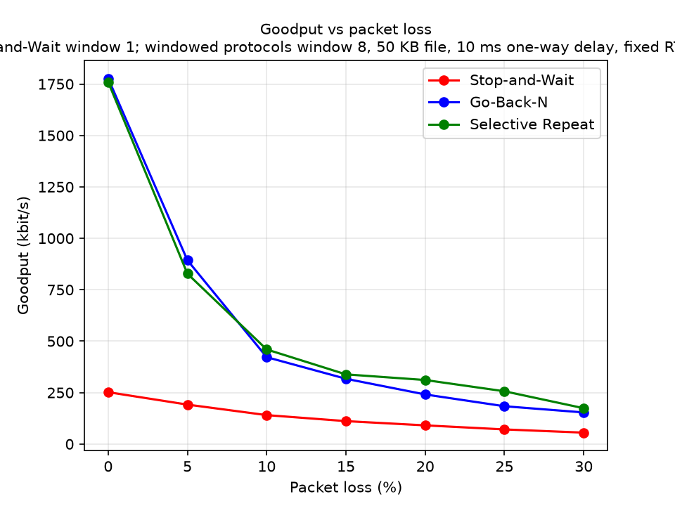
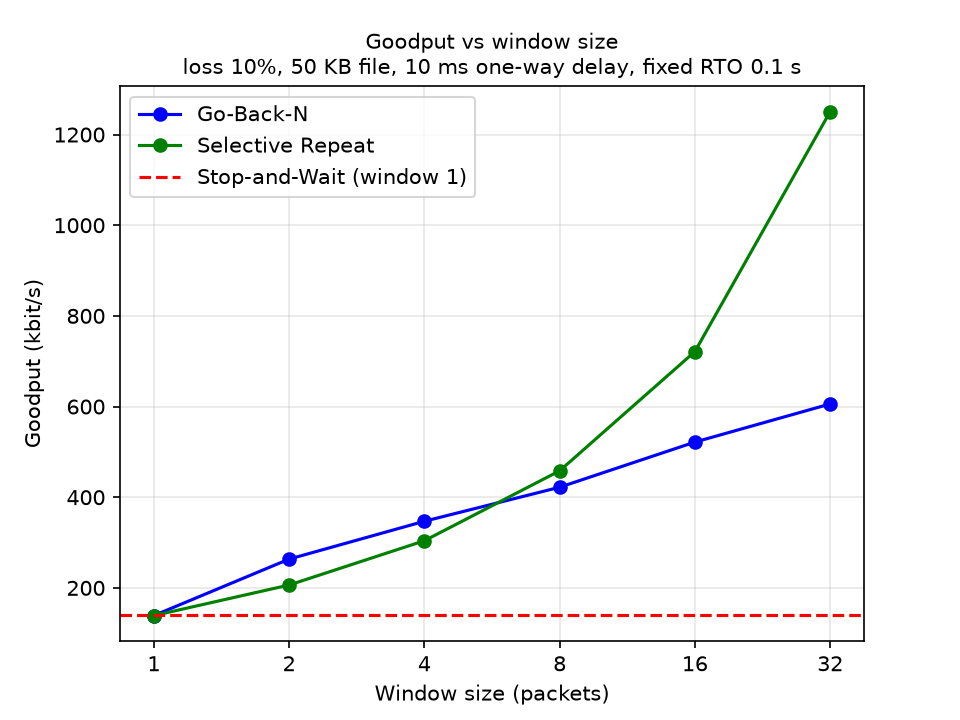
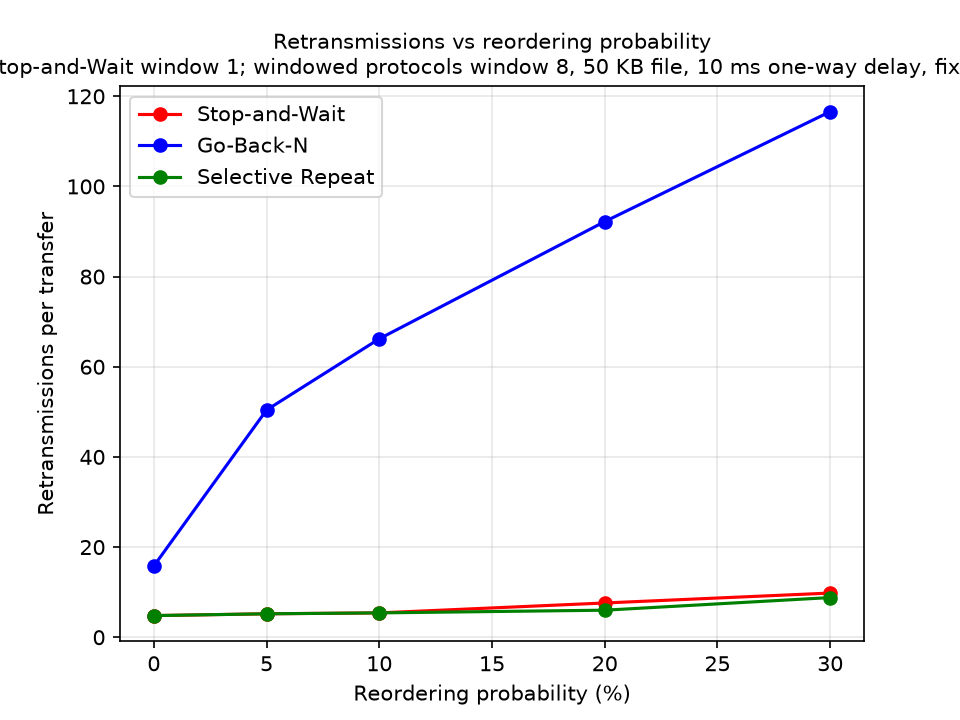

# Datagram: reliable file transfer over UDP

UDP only sends bytes to an address. It does not promise delivery, order, uniqueness or integrity. Datagram adds those promises in plain Python, on top of raw UDP sockets:

- **Sequence numbers** for order and duplicate detection
- **A hand-written CRC-32 checksum** for corruption
- **Acknowledgements, timers and retransmission** for loss
- **Three swappable ARQ protocols**: Stop-and-Wait, Go-Back-N and Selective Repeat
- **An adaptive retransmission timeout** (Jacobson/Karels with Karn's rule) that learns the timer from measured round-trip times
- **A seeded channel emulator** that injects loss, corruption, duplication, reordering and delay, so every protocol can be tested and compared under identical conditions
- **SHA-256 verification** of every transfer: the sent and received files must have the same fingerprint

## Quick start

```bash
pip install -r requirements.txt
python -m pytest -q
python -m datagram demo
```

`demo` sends a 50 KB random file through localhost UDP once per protocol and compares SHA-256 of the file that went in with the file that came out. Add `--loss 0.2` (or other fault flags) to demonstrate recovery. Example output (your numbers will differ):

```
protocol          packets sent  retransmits  seconds     KB/s   result
Stop-and-Wait               78           27     2.73     18.3   PASS (sha256 match)
Go-Back-N                  173          122     1.73     28.9   PASS (sha256 match)
Selective Repeat            78           27     1.77     28.3   PASS (sha256 match)
```

Send a real file between two terminals (start the receiver first):

```bash
python -m datagram receive --port 9101 --peer 127.0.0.1:9100 --out got.bin --protocol sr --loss 0.2
python -m datagram send    --port 9100 --peer 127.0.0.1:9101 --file photo.jpg --protocol sr --loss 0.2
```

Both sides print the same SHA-256 when the file arrives intact. Options: `--protocol sw|gbn|sr`, `--window`, `--rto`, `--adaptive`, `--reset`, the channel faults `--loss --corrupt --dup --reorder --delay --jitter`, and `--seed` for repeatable runs. `python -m datagram --help` lists everything.

## How it works

```
file -> 1 KB chunks -> Packet (15-byte header + CRC-32) -> Channel (loss, corruption, ...) -> UDP socket
                                                                                              |
file <- in-order chunks <- receiver (checks CRC, ACKs) <---------------- ACKs (can be lost too) +
```

| Module | Job |
|---|---|
| `datagram/packet.py` | Packet header (`seq`, `ack`, `flags`, length, checksum) and the hand-written CRC-32. `unpack()` returns `None` for a corrupt or truncated packet, which receivers treat like a lost one |
| `datagram/channel.py` | The emulated network between a protocol and the socket (see below) |
| `datagram/protocols/` | `stop_wait.py`, `gbn.py` and `sr.py`, all behind the `ARQProtocol` interface in `base.py`: `send_file(path)` and `receive_file(path)`, each returning `packets_sent`, `retransmissions`, `bytes_delivered` and `elapsed_s` |
| `datagram/rto.py` | `RTOEstimator`: turns RTT samples into a timeout |
| `datagram/timers.py` | `RTTTracker`: applies Karn's rule between a protocol and the estimator |
| `datagram/app.py` | The command-line app (`demo`, `send`, `receive`) |
| `experiments/` | Harness, sweeps and plots that produce `results/` |

## The three protocols

| Protocol | Rule | ACKs |
|---|---|---|
| **Stop-and-Wait** | Send one packet, wait for its ACK, resend on timeout | One per packet |
| **Go-Back-N** | Up to `window` packets in flight, one timer for the oldest. A timeout resends the whole window. The receiver accepts only in-order packets | Cumulative: `ack = N` means everything up to N arrived |
| **Selective Repeat** | Up to `window` packets in flight, each with its own timer. Only expired packets are resent. The receiver buffers out-of-order packets and delivers them in order | One per packet |

Every protocol ends a file with a `FIN` packet. The receiver then lingers briefly and re-ACKs repeated FINs, so a lost final ACK does not strand the sender. Duplicates are re-ACKed but never written twice.

**Selective Repeat's receiver has three cases:** below the window, re-ACK it but do not deliver it again; inside the window, ACK it, buffer it if new, and deliver everything consecutive from `rcv_base`; beyond the window, ignore it.

## Adaptive timeout (`rto.py`, `timers.py`)

- `RTOEstimator` follows RFC 6298. The first sample sets SRTT = R and RTTVAR = R/2. After that, RTTVAR updates first and then SRTT (weights 1/4 and 1/8). RTO = SRTT + 4 x RTTVAR, clamped to `[min_rto, max_rto]`. Each timeout doubles the RTO (exponential backoff). `RTOEstimator(fixed=x)` is a fixed-timeout baseline that never learns.
- `RTTTracker` enforces **Karn's rule**: no RTT sample from a packet that was resent, because its ACK is ambiguous. Protocols call `on_send(seq, now)`, `on_ack(seq, now)` and `on_timeout(seq)`. If several packets time out together, only the first backs the RTO off (`backoff=False` for the rest). `discard(seq)` forgets a packet without measuring it, for cumulative ACKs.
- `reset_on_retx_ack=True` is an optional deviation from textbook Karn: when a resent packet is finally ACKed, the RTO returns to the formula value (still without a sample). Without it, at 20-30% loss the backed-off RTO stays high and transfers slow down sharply or stall.
- All three protocols take `est=` and `reset_on_retx_ack=`. With no `est`, Stop-and-Wait and Selective Repeat are adaptive and Go-Back-N is fixed at `rto`. When `est` is given, `rto=` only sets the receiver's linger time in Stop-and-Wait and Selective Repeat.

## Channel emulator (`channel.py`)

| Parameter | Effect |
|---|---|
| `loss` | Probability a packet is dropped |
| `corrupt` | Probability one bit is flipped (in the payload when there is one, otherwise in the header; either way the checksum catches it) |
| `dup` | Probability a packet is delivered twice |
| `reorder`, `reorder_delay` | Probability a packet is held back, so later packets overtake it |
| `delay`, `jitter` | Base one-way delay and its random variation |
| `seed` | Seeds the channel's own random generator: the same seed gives the same sequence of bad luck |

Delayed packets wait in a queue until `pump()` delivers them, so protocol loops call `pump()` regularly. `channel.stats` counts sent, dropped, corrupted, duplicated and delivered packets.

## Packet format

| Field | Size | Meaning |
|---|---|---|
| `seq` | 4 bytes | Packet index (counts packets, not bytes) |
| `ack` | 4 bytes | Which packet is acknowledged |
| `flags` | 1 byte | `DATA`, `ACK`, `FIN` bits |
| `payload_len` | 2 bytes | Bytes of data that follow |
| `checksum` | 4 bytes | CRC-32 over header (checksum field zeroed) and payload |

The header is 15 bytes in network byte order. The payload is at most 1024 bytes.

## Experiments and results

`experiments/` runs four sweeps and plots them: goodput against loss (exp1), against window size (exp2), retransmissions against reordering (exp3), and RTO variants (exp4, Selective Repeat only). Setup: 50,000-byte file, 5 seeds per configuration, 10 ms one-way delay, one shared fixed RTO of 0.1 s (except exp4).

```bash
python -m experiments.run_sweeps   # writes results/*.csv (edit `which` and `quick` at the bottom of the file)
python -m experiments.plots        # writes results/*.png and prints the claim and SHA-256 checks
```





What the data shows (mean of 5 seeds):

- **Windowed protocols beat Stop-and-Wait everywhere.** At 0% loss, about 1.7 Mbit/s against about 0.25 Mbit/s.
- **Selective Repeat leads Go-Back-N at moderate and high loss.** Fresh averages: at 10, 15, 20, 25 and 30% loss, SR is about 0.460, 0.339, 0.311, 0.256 and 0.174 Mbit/s versus GBN at 0.422, 0.317, 0.241, 0.184 and 0.154 Mbit/s. At 5% loss GBN remains slightly ahead.
- **Both windowed protocols beat Stop-and-Wait.** Stop-and-Wait averages 0.140 Mbit/s at window 1. GBN is 0.263-0.606 Mbit/s and SR is 0.206-1.251 Mbit/s at windows 2-32.
- **Window size.** GBN is ahead at windows 2 and 4. SR is ahead at windows 8, 16 and 32; the practical conclusion is a clear SR advantage only at larger windows in this sweep.
- **Retransmissions.** Mean retransmissions rise under reordering for GBN from 15.8 to 116.6 from 0% to 30%. SR stays from 4.8 to 8.8 over the same range.
- **Adaptive RTO loses to a fixed 0.05 s timeout** on this emulated link: about 0.32 vs 0.70 Mbit/s at 10% loss, and 0.027 vs 0.288 Mbit/s at 30% loss. Backoff-reset improves the adaptive result to about 0.42 Mbit/s at 10% loss and 0.286 Mbit/s at 20% loss.
- **The fresh exp4 sweep has no failed trials.** All 100 RTO-variant runs completed and matched SHA-256, including all five seeds at 30% loss.

Every completed transfer is checked by SHA-256, and `plots.py` reports any mismatch or failed trial.

## Tests

`python -m pytest -q` runs 400+ tests: packet and CRC, the channel (with a fake clock), the estimator and tracker (hand-computed values), each protocol's sender and receiver logic, end-to-end transfers over real UDP sockets for all three protocols (loss, corruption, duplication, reordering, delay, window sizes, file sizes from 0 to 50,000 bytes), and the command-line app. Every transfer test ends with a SHA-256 comparison, because a run that finishes without an error does not prove the file is right.

## Limitations

- Everything runs on loopback with an emulated channel, so results compare protocols against each other, not real network performance.
- Loss is independent per packet (no bursts), and corruption flips exactly one bit, which CRC-32 always detects.
- Go-Back-N defaults to a fixed timeout. With adaptive RTO under heavy loss, use `reset_on_retx_ack=True` or a larger linger.
- Selective Repeat can stall when the ACK for its oldest packet is lost, because only that packet's own timer releases the window. This is the likely reason Go-Back-N is ahead at low loss when ACKs can be lost too.
- No congestion control, flow control or connection handshake. Sequence numbers are 32-bit and never wrap.
- The sweeps use one file size and one delay.

## Origin

Datagram started as a four-person course project (Sanvi Shan, Samridhya Mukherjee, Akshita Singh and Shilpa Kumari). The submitted version is tagged `v1.0-submission` and its full commit history is preserved here. The command-line app (`python -m datagram`) was added in this version.